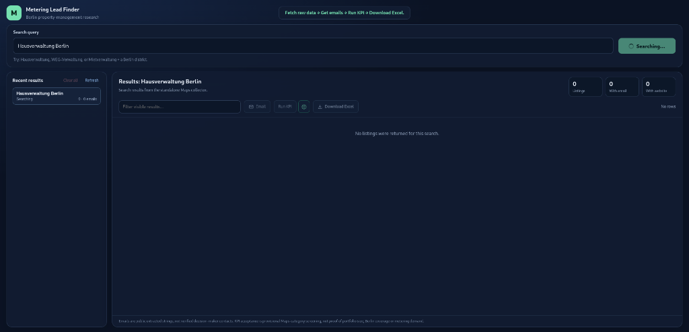
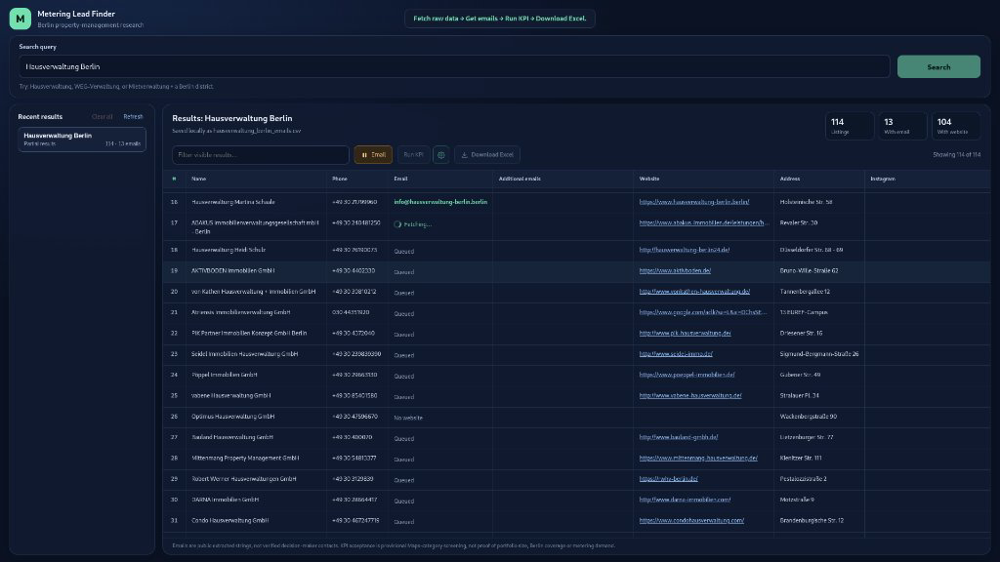
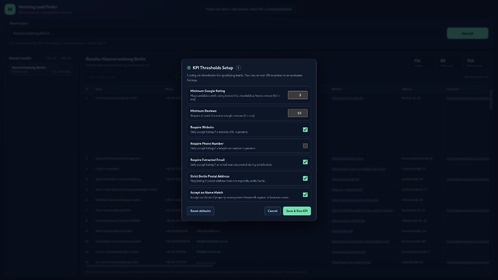
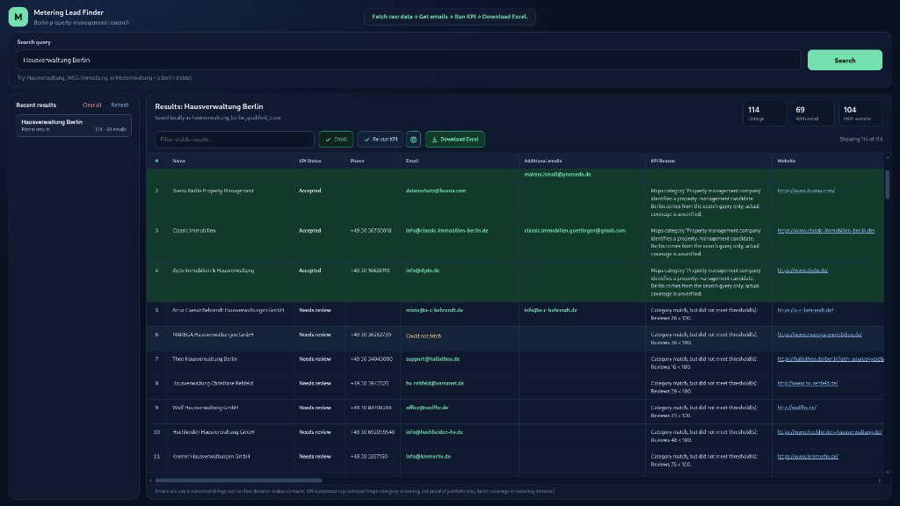

# Metering Lead Finder

A local web application for discovering, enriching, qualifying, and exporting Berlin property-management leads for metering service providers.

The app uses a bundled Chrome extension inside Chromium to collect Google Maps listings, enriches them with public website contacts and emails, applies rule-based qualification thresholds, and exports a formatted Excel workbook.

```text
Dashboard -> FastAPI -> Chromium (HEADLESS=true/false)
                          -> Bundled extension -> Google Maps listings
                          -> Background worker -> Website email discovery
          <- Table view + CSV checkpoints + Formatted Excel (.xlsx) export
```

---

## Quick Start

### 1. Requirements

- Linux or macOS with Python 3.10+
- Chromium browser dependencies (installed via Playwright)

### 2. Setup and Installation

```bash
cd /metering
python3 -m venv .venv
source .venv/bin/activate
pip install -r requirements.txt
python -m playwright install chromium
```

### 3. Configuration

Copy `.env.example` to `.env` (optional, defaults to headless):

```bash
cp .env.example .env
```

```dotenv
HEADLESS=true
```

- `true`: Chromium runs in the background without opening a browser window.
- `false`: Displays the live Chromium window during searches and email lookups (requires an active desktop/X11 session).

### 4. Start the Application

```bash
uvicorn app:app --host 127.0.0.1 --port 3000
```

Open [http://127.0.0.1:3000](http://127.0.0.1:3000) in your browser.

---

## The Four-Stage Workflow

The pipeline runs in four distinct stages. Each step requires manual selection and confirms its prerequisites before running:

```text
Fetch raw data  ->  Get emails  ->  Run KPI  ->  Download Excel
```

```
[Search] -> Collect raw Google Maps listings
[Email]  -> Crawl company websites for emails and social links (with pause / resume)
[Run KPI]-> Evaluate candidate qualification using custom or default thresholds
[Excel]  -> Export two-sheet workbook with color-coded rows and audit rules
```

---

### Stage 1: Fetch Raw Data (Google Maps Collection)

Enter a targeted search query (e.g. `Hausverwaltung Berlin`, `WEG-Verwaltung Berlin`, or `Mietverwaltung Berlin`) and click **Search**.

- Python launches Chromium with the bundled extension and navigates Google Maps.
- The extension automatically scrolls through listings, handles idle delays, and continues until Maps reports that the end of the list has been reached.
- Real-time search status displays directly on the primary action button (`Searching...` with spinner).
- The raw results are saved immediately to disk as `output/<query>_raw.csv`.


*Figure 1: Full-width dashboard layout showing centered navbar progress, search input, and active collection.*

---

### Stage 2: Get Emails (Website Contact Enrichment)

Once raw listings appear in the table, the **Email** button becomes active. Clicking it triggers website contact extraction:

- The extension background worker visits each company website and scans contact/imprint pages for public email addresses and social links (LinkedIn, Instagram, Facebook).
- **Pause and resume controls**:
  - While running, the button shows `[||] Email`. Clicking it pauses after the active listing finishes.
  - While paused, the button shows `[>] Email`. Clicking it resumes from the next queued row.
  - On completion, the button shows `[v] Email`.
- The live table updates per row: showing `Fetching...` on the active company, `Queued` on pending rows, and the discovered email once found.
- Progress checkpoints continuously to `output/<query>_emails.csv` without overwriting raw data.


*Figure 2: Active email discovery showing the pause button, per-row lookup states, and extracted contact details.*

---

### Stage 3: KPI Thresholds Setup and Qualification

After email lookup finishes, the **Run KPI** button and the **Setup** gear icon (`⚙`) become available.

Clicking the setup icon opens the **KPI Thresholds Setup** modal. You can review the criteria, adjust thresholds, and re-run KPI evaluations as many times as needed:

- **Info disclosure (`i`)**: Clicking the info icon beside the modal title displays the screening criteria and color key.
- **Configurable threshold parameters**:
  - **Minimum Google Rating**: Flag candidates below this rating as Needs review (default: `3.0`).
  - **Minimum Reviews**: Require at least this many Google reviews (default: `10`).
  - **Require Website**: Only accept listings with an active website URL (default: `true`).
  - **Require Phone Number**: Only accept listings with a listed phone number (default: `false`).
  - **Require Extracted Email**: Only accept listings where an email was found (default: `true`).
  - **Strict Berlin Postal Address**: Flag listings whose postal address does not verify Berlin (default: `true`).
  - **Accept on Name Match**: Accept candidates if property-management keywords appear in business name even if Google Maps categorized them broadly as a real estate broker (default: `true`).
- **Reset defaults**: Restores recommended baseline settings with one click.
- **Re-run anytime**: You can adjust thresholds and click **Save & Run KPI** repeatedly to experiment with different qualification criteria.


*Figure 3: KPI Thresholds Setup modal with screening info disclosure and configurable threshold controls.*

---

### Stage 4: Results Table and Excel Workbook Export

Applying KPI thresholds updates the results table and unlocks the **Download Excel** button:

- **Row color coding**:
  - **Green (Accepted)**: Matches all property-management criteria and passes all threshold gates.
  - **Red (Rejected)**: Category is unrelated to property management with no matching signals.
  - **Neutral (Needs review)**: Ambiguous categories, missing evidence, or failed threshold gates (e.g. fewer than 10 reviews, missing email, or rating under 3.0).
- **Download Excel**: Generates a formatted `.xlsx` workbook containing:
  - **Qualified leads sheet**: Full listing data, extracted emails, qualification status, and detailed reason notes. Rows match the dashboard's green/red color styling, with frozen header rows and auto-filters.
  - **KPI criteria sheet**: Complete audit record of the active thresholds, query details, timestamp, and methodology limits.
  - Contact fields and numbers are saved as clean text to prevent spreadsheet formula corruption.


*Figure 4: Screened leads table showing color-coded qualification statuses, Re-run KPI button, and Excel download ready.*

---

## Default KPI Thresholds Reference

| Parameter | Default | Rationale |
| :--- | :---: | :--- |
| **Minimum Reviews** | `10` | Filters out placeholder listings while retaining established local property managers. |
| **Minimum Google Rating** | `3.0` | Balanced cutoff. Many large, high-volume managers receive negative reviews from tenants regarding repairs. Setting this too high eliminates top-tier targets. |
| **Require Website** | `true` | Ensures the business has an active digital presence for outreach and research. |
| **Require Extracted Email** | `true` | Focuses the Accepted shortlist on candidates ready for email communication. |
| **Strict Berlin Postal Address** | `true` | Confirms the physical address is in Berlin's postal code area (10000 - 14199), excluding out-of-state aggregators. |
| **Accept on Name Match** | `true` | Accepts firms whose Google category is generic (e.g. *Immobilienmakler*), but whose name explicitly says *Hausverwaltung* or *Mietverwaltung*. |
| **Require Phone Number** | `false` | Kept optional so candidates with confirmed websites and emails are not excluded if phone is omitted. |

---

## Evidence Boundaries and Validation Limits

1. **Google Maps is discovery, not commercial proof**:
   A Maps listing confirms a business name, category, and address. It does not prove managed unit count, building types, active metering provider, or purchasing authority.
2. **Search context vs. geographic proof**:
   A business appearing in a search for "Hausverwaltung Berlin" is marked with search context. Only an explicit Berlin postal address verifies local office presence.
3. **Extracted emails are public discovery strings**:
   Emails found on websites are public general inboxes (e.g. `info@...`, `kontakt@...`), not verified personal decision-maker contacts. No automated emails are ever sent by this tool.
4. **Unknowns remain Unknown**:
   Portfolio scale, managed units, and commercial intent remain `Unknown`. Ratings and reviews are not used as proxies for company size or buying fit.
5. **Human review required before outreach**:
   Accepted records are provisional candidates for further research, not confirmed customer endorsements.

---

## Project Structure

```text
metering/
├── app.py                      # FastAPI server, endpoints, and KPI qualification logic
├── csv_output.py               # openpyxl Excel (.xlsx) and CSV export utilities
├── requirements.txt            # Python dependencies (FastAPI, Playwright, openpyxl, etc.)
├── .env.example                # Example environment template
├── .env                        # Local environment settings (HEADLESS=true/false)
├── static/
│   └── index.html              # Single-page dashboard (HTML, CSS, vanilla JavaScript)
├── extension_bundle/           # Bundled Chrome scraping extension and Playwright runner
│   ├── run_hermes_scrape.py    # Automation harness for Maps collection and email extraction
│   ├── manifest.json           # Extension manifest
│   ├── contentScript.js        # Maps DOM scraper
│   └── background.js           # Background service worker for website email lookups
├── output/                     # Generated CSV and Excel exports (gitignored)
│   ├── <query>_raw.csv         # Raw Google Maps collection
│   ├── <query>_emails.csv      # Contact-enriched derivative
│   └── <query>_qualified.csv   # KPI-screened dataset
└── docs/                       # Research documentation and figures
    ├── images/                 # Workflow screenshots
    │   ├── 01-search-dashboard.png
    │   ├── 02-email-enrichment.png
    │   ├── 03-kpi-thresholds-modal.png
    │   └── 04-kpi-results-table.png
    └── task-3-approach-draft.docx  # Formatted Word documentation with embedded figures
```

---

## API Endpoints

| Method | Endpoint | Description |
| :--- | :--- | :--- |
| `POST` | `/api/jobs` | Start a new Google Maps search job for a given query. |
| `GET` | `/api/jobs/{id}` | Get status, live progress, and results for a job. |
| `POST` | `/api/jobs/{id}/emails` | Start website email enrichment. |
| `POST` | `/api/jobs/{id}/emails/pause` | Pause active website email enrichment. |
| `POST` | `/api/jobs/{id}/emails/resume` | Resume paused email enrichment. |
| `POST` | `/api/jobs/{id}/kpi` | Run or re-run KPI qualification with custom thresholds. |
| `GET` | `/api/jobs/{id}/excel` | Download the formatted `.xlsx` workbook. |
| `GET` | `/api/history` | List recent search jobs in memory. |
| `DELETE`| `/api/jobs` | Clear in-memory history (disk exports are preserved). |
